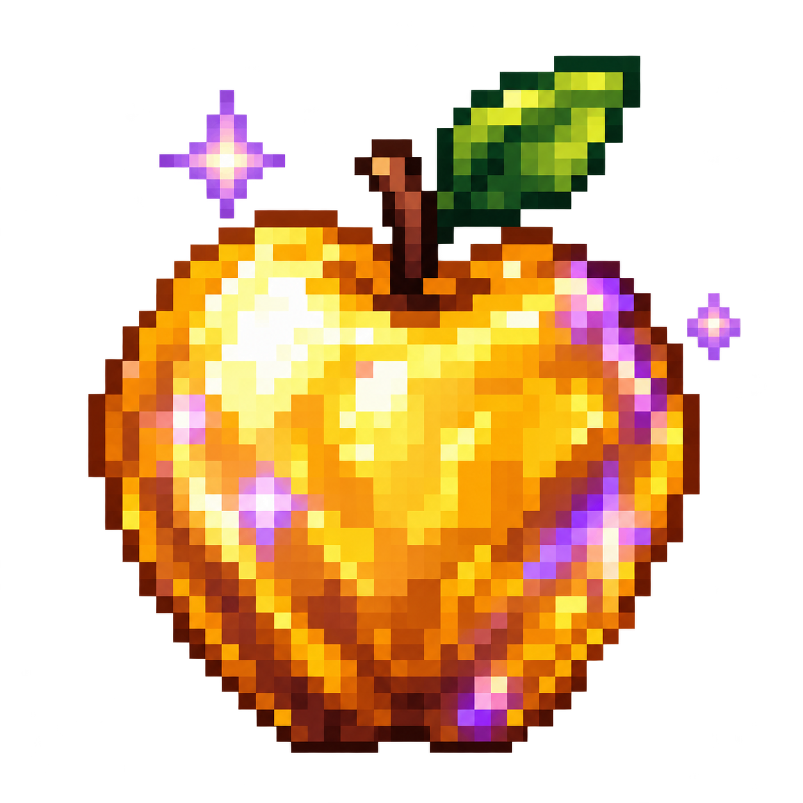

<p align="center"></p>

# Notch Apple

A music-first island for the Mac notch, with an enchanted golden apple theme. Based on [Boring Notch](https://github.com/TheBoredTeam/boring.notch).

[**Download for Apple Silicon**](https://github.com/leozh0u/notch-apple/releases/latest/download/Notch-Apple-arm64.dmg) · [Download for Intel](https://github.com/leozh0u/notch-apple/releases/latest/download/Notch-Apple-x86_64.dmg) · [All releases and source](https://github.com/leozh0u/notch-apple/releases)

Requires macOS 14 or later. This is an early preview, locally ad-hoc signed and **not notarised**. macOS may block the downloaded app on first launch; see [Apple's guidance](https://support.apple.com/guide/mac-help/open-a-mac-app-from-an-unknown-developer-mh40616/mac). No security-disabling terminal commands are required by this project.

## Use it

1. Open the DMG and drag **Notch Apple** into **Applications**.
2. Launch it, choose a music source, then hover over your notch.
3. Spotify is the default for new installs. Use **Open Spotify** when it is closed; macOS may ask for permission to control it. Apple Music, Now Playing and YouTube Music remain available in Settings.

The menu-bar icon opens Settings and Spotify. **Keep island open** pins the panel; the focus timer is a separate feature and closes the panel when started. Command-Shift-N toggles pinning while the app is active. Automatic updates are disabled; download a new release to update.

## What is here

- **Music:** artwork, playback progress, configurable controls, subtle playback bars and a gold/purple theme. The bars animate with playback; they do not sample your audio or microphone. Spotify's favourite action is not supported.
- **Focus timer:** drag a circular dial or type exact minutes and seconds, from 1 second to 12 hours. Pause, resume or end the session. It accounts for sleep and resets when the app quits. It does not block apps or websites.
- **Upcoming calendar:** the day, date and next two events from selected macOS calendars. To include Google Calendar, add your Google account in **macOS Calendar → Add Account**, then use **Settings → Calendar → Connect Calendar**. No separate Google credentials are stored by Notch Apple.
- **Shelf:** temporarily stage files and links, then open, drag out or share them. Drag files from Finder or use **Add files…**. Original files are not moved or deleted. Removing an item removes its shelf reference or app-owned temporary copy.
- **Menu-bar space:** the compact panel stays attached to the top edge, below system menu windows in stacking order. There is one Home/Shelf navigation, with no duplicate Shelf shortcut.

Appearance settings can turn off the theme, new recurring animations or the focus row. Calendar, mirror and system HUD access are optional and requested when used. The new music and idle-companion animations respect Reduce Motion.

## Resource use and privacy

Release builds use size optimisation. Artwork is downsampled before display; average-colour sampling is bounded. Artwork cache limits are 4 MiB in memory and 16 MiB on disk, rather than the inherited 50/100 MiB limits. Those are limits, not reserved allocations. Paused playback displays stop their recurring timelines; Spotify does not start the generic Now Playing helper stream.

There is no analytics service or account server. Remote artwork is fetched from its source; optional lyrics lookup sends the track/artist to a lyrics provider only when enabled. Calendar events are read locally through EventKit. The inherited system HUD helper needs accessibility access for that feature. Ad-hoc preview builds retain the app sandbox and hardened runtime, with a library-validation exception for their bundled ad-hoc frameworks. Developer ID distribution should sign dependencies with one team instead. Public release assets include licence notices and matching source through each GitHub tag.

## Build and check

Use Xcode 26 or later. The upstream build instructions require macOS 15.6 or later; development and local UI verification used Xcode 27 on macOS 26.6.2. Intel binaries are cross-built; hardware coverage is recorded per release.

```sh
./scripts/test.sh
./scripts/test-artwork.sh
./scripts/test-shelf.sh
python3 Tests/check-upcoming-calendar.py
./scripts/build-local.sh
open "build/Build/Products/Release/Notch Apple.app"
```

The first build resolves Swift packages. Set `NOTCH_APPLE_BUILD_DIR` to reuse another build cache. Source directories and Xcode targets retain upstream names to keep merges manageable. The icon's source and prompt are in [design/icon-provenance.md](design/icon-provenance.md).

## Origin and licence

Notch Apple modifications began on 15 October 2026, based on TheBoredTeam/boring.notch at `64b545929cf31681e09b5c375859c1eceeb733eb`. Original authorship and history are retained. See [README.upstream.md](README.upstream.md), [GPL v3](LICENSE) and [third-party notices](THIRD_PARTY_LICENSES). The original release workflows are preserved but disabled in `.github/upstream-workflows`.

Not affiliated with Apple, Mojang, Microsoft or TheBoredTeam. The golden apple artwork is an original Minecraft-inspired illustration, not an extracted game asset.
